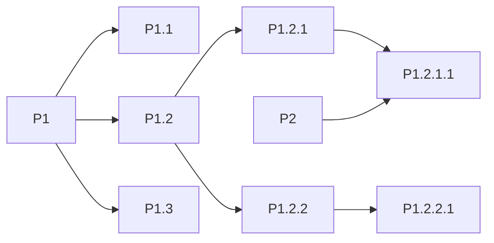

# ADR 01 — Lineage Capability: Partitioning Linking, Flow Membership and Explicit Edges

|                         |                                                                                                                                                                                                    |
|-------------------------|----------------------------------------------------------------------------------------------------------------------------------------------------------------------------------------------------|
| **Status**              | Accepted                                                                                                                                                                                           |
| **Date**                | 2026-11-19                                                                                                                                                                                         |
| **Affected components** | `database/`, `server/`, `model/`, `agent/`, `api-tests/`                                                                                                                                           |
| **Issue / PRs**         | [#475](https://github.com/AbsaOSS/atum-service/issues/475) / [#496](https://github.com/AbsaOSS/atum-service/pull/496) (multi-parent linking), [#503](https://github.com/AbsaOSS/atum-service/pull/503) (explicit edges), [#493](https://github.com/AbsaOSS/atum-service/pull/493) (bounded graph traversal) |

This ADR records the linking ("lineage") design across #496 (closure semantics and consolidated v2 create), #503
(explicit direct edges and the `lineage` schema), and #493 (bounded graph traversal).

---

## 1. Context and scope

Atum partitionings can declare upstream *parent* partitionings (e.g., curation derived from raw ingestion). Before #475
(v0.10.0), relationships existed only as transitive **flow membership** (`flows.partitioning_to_flow`): creation took at
most one parent (`parentPartitioning`), linking happened over multiple round trips (`GET`/`POST`/`PATCH`), linking
implicitly copied measure definitions and additional data, nothing prevented cycles via `PATCH`, and retroactive linking
of a partitioning with existing descendants had undefined/unbounded propagation behaviour.

Goals: allow **0..N parents** on creation, make linking **idempotent, cycle-free, and bounded**, make data copying
**explicit and minimal**, and expose **direct-edge graph reads** alongside the existing transitive flow closure. Edges
and flow membership still record what producers declared, not proof of physical data consumption.

---

## 2. Decision summary

| #   | Decision                                                                                                                                                                                                                               |
|-----|----------------------------------------------------------------------------------------------------------------------------------------------------------------------------------------------------------------------------------------|
| D1  | **Consolidated create:** `POST /api/v2/partitionings` takes **0..N parents** (max 100 distinct, `400` beyond). Idempotent: `201` created, `200` existing (stored `author`). Legacy single `parentPartitioningId` is still decoded.       |
| D2  | **Single linking routine:** `lineage.link_to_parents` is shared by `POST /api/v2/partitionings` and `PATCH /api/v2/partitionings/{id}/ancestors`.                                                                                      |
| D3  | **Cycle detection:** Self-links and parents that are already descendants are rejected with `409` (DB status `32`) before any write.                                                                                                    |
| D4  | **Closure invariant:** `members(F(A)) = {A} ∪ descendants(A)`. A newly created child joins every flow containing any of its parents.                                                                                                   |
| D5  | **No descendant propagation:** Linking an *existing* partitioning that already has descendants under a new parent is **refused** (`409`, DB status `33`, nothing written). Creation-time linking is unaffected because new nodes are leaves. |
| D6  | **Minimal copy policy:** `POST` **never** copies additional data, and copies measure definitions only when `copyMeasureDefinitions = true` (default `false`; legacy v0.6–v0.10 `parentPartitioningId` bodies without the flag default to `true`), only on creation, as the distinct union over parents (child wins). `PATCH .../ancestors` requires both copy flags explicitly (`400` if omitted); `copyAdditionalData=true` overwrites same-named child keys. |
| D7  | **API v1 deprecated:** Flagged deprecated in Swagger and README (v1-only agents ≤ v0.5.x are retired).                                                                                                                                 |
| D8  | **Deploy server before agents:** Agents must be same version or older than the server.                                                                                                                                                 |
| D9  | **Hybrid dual write (#503):** `lineage.partitioning_edges` stores direct `parent -> child` edges alongside the closure in the same transaction. Forward-only (no migration backfill); closure stays authoritative for transitive reads and cycle/leaf checks (§7). |
| D10 | **Dedicated `lineage` schema (#503, #493):** Owns `partitioning_edges` and lineage functions (`link_to_parents`, `get_direct_parents`, `get_direct_children`, `get_partitioning_ancestors`, `get_partitioning_descendants`, `get_partitioning_lineage_graph`) with a direct cutover (no compatibility wrappers). |

---

## 3. Mechanics

### 3.1 Flow closure vs. explicit edges

- Every partitioning gets a **main flow** `F(A)` (`flows.flows.fk_primary_partitioning = A`), containing `{A} ∪ descendants(A)`.
- **Ancestors of X** (`GET .../ancestors`) = primary partitionings of flows containing `X`, excluding `X` (non-recursive lookup over `flows.partitioning_to_flow`). Returns all intermediate and root ancestors without distinguishing direct parents.
- **Direct edges** (`GET .../parents`, `.../children`, `.../lineage`) query `lineage.partitioning_edges` and include `linkedBy`/`linkedAt`.

### 3.2 `lineage.link_to_parents(child, parents[], user)`

1. **Validate:** `i_by_user` non-`NULL` (`51`), normalize `parents` (drop `NULL`s/duplicates), verify child (`42`) and all parents (`41`) exist.
2. **Self-link check:** `child ∈ parents` → `32` (checked first because a child is always in its own main flow).
3. **Lock-free fast path:** If every parent is already an ancestor of `child` (re-run or edge backfill), insert only missing edges (`ON CONFLICT DO NOTHING`) → `11` if edges added, `14` if unchanged. Safe even if `child` has descendants.
4. **Slow path (advisory lock):** Acquire transaction-scoped global lock `atum.flows.link_to_parents` (requires `READ COMMITTED`, the Hikari default; callers must not hold `FOR UPDATE` locks).
5. **Cycle & leaf checks:** Parent in `F(child)` → `32` (cycle); `F(child)` has members other than `child` → `33` (non-leaf refused, D5); parent has no flow membership → `50` (corrupt data).
6. **Write:** Insert edges, then add `child` to every flow containing any parent (`11` or `14`).

Every non-OK status in `link_to_parents` is returned **before any write** because `fa-db` commits before inspecting status. (`runs.create_partitioning_with_parents` creates a new child and its main flow before calling `link_to_parents`, so `3x`/`4x` cannot occur for new children; a `50` on a corrupt parent would leave the new child committed.)

### 3.3 Entry points and HTTP mapping

- **`runs.create_partitioning_with_parents`**: creates/reuses partitioning, calls `link_to_parents`, copies measure definitions only if newly created and `copyMeasureDefinitions = true`. Statuses: `11` created (no parents) / `12` created with parents → `201`; `13` new parent linked to existing / `14` already linked → `200`.
- **`runs.update_partitioning_parent`** (`PATCH .../ancestors`): calls `link_to_parents`, then applies both copy flags even on existing links (measure definitions `ON CONFLICT DO NOTHING`; additional data overwrites) → `204`.
- **Errors:** `400` (>100 distinct parents or missing `PATCH` copy flags), `404` (status `41`/`42`), `409` (status `32` cycle / `33` non-leaf).

### 3.4 Concurrency caveat

The global advisory lock has no `lock_timeout` (10-connection Hikari pool). The deprecated lock-free **v1** create can race a concurrent v2 link of its parent under a new ancestor and miss that ancestor's flow for the brand-new child; no repair tool ships.

---

## 4. Examples

Ingest creates `P1` and children `P1.1`, `P1.2`, `P1.3`; Curate creates `P1.2.1`, `P1.2.2` under `P1.2`, plus `P1.2.1.1` (diamond: parents `P1.2.1` and `P2`) and `P1.2.2.1` (parent `P1.2.2`), all upstream-before-downstream:

- **Flows:** `F(P1)` contains all 8 `P1*` nodes (not `P2`); `F(P1.2)` contains `{P1.2, P1.2.1, P1.2.2, P1.2.1.1, P1.2.2.1}`; `F(P2)` contains `{P2, P1.2.1.1}`.
- **Edges vs. ancestors:** `GET .../parents` of `P1.2.1.1` returns `{P1.2.1, P2}`; `GET .../ancestors` returns `{P1.2.1, P1.2, P1, P2}`.
- **Retroactive linking (D5):** If `P1.2.1` is created parentless with child `P1.2.1.1`, a later `PATCH` linking `P1.2.1` under `P1.2` is refused with `409` (status `33`).
- **Why silent non-propagation is unsound:** If `C` is under `B` and `B` were linked under `A` without adding `C` to `F(A)`, then `C ∉ F(A)` would allow linking `A` under `C` and create cycle `A -> B -> C -> A` (making cycle checks and flows order-dependent).

---

## 5. Alternatives considered

| Option | Verdict |
|---|---|
| **A. Propagate descendants on `PATCH`** | Rejected: irreversible (no unlink), surprising diamond fan-out, unbounded writes under global lock, larger test/doc surface. |
| **B. Silently drop propagation** | Rejected: breaks closure invariant and cycle detection (§4). |
| **C. Edge table only (recursive cycle check, no closure)** | Rejected as replacement in #496 (breaks existing flow/ancestor semantics); **adopted additively in #503** (§7). |
| **D. Flow = X + direct children only** | Rejected: breaks single-timeline flow and `GET .../ancestors`. |
| **E. Opt-in propagation (`includeDescendants`)** | Deferred (§8). |
| **F. Refuse linking non-leaf children (chosen)** | Keeps closure invariant and sound cycle detection with bounded writes. |

---

## 6. Consequences

- **Positive:** Closure invariant holds by construction; transitive reads and cycle checks stay non-recursive; writes per link are bounded; upstream-first pipelines are unaffected and idempotent.
- **Trade-offs:** Missed links above existing descendants require manual DBA repair; downstream-first builders must switch to upstream-first creation; legacy pre-v0.11.0 data has no edges; agents v0.8–v0.10 treat `PATCH 409` as "already linked" (server logs a `WARN`); still uses one global advisory lock with no `lock_timeout` and no unlink API.

---

## 7. Hybrid edges, schema responsibilities, and graph reads (#503, #493)

- **Why hybrid:** Closure reads stay fast (`O(1)` indexed lookup) and non-breaking, while `lineage.partitioning_edges` (`PK (fk_child, fk_parent)`, index `(fk_parent, fk_child)`, self-loop `CHECK`) serves direct provenance and graph visualization.
- **Forward-only gap:** Links created in v0.10.0 or earlier have no edges (`parents`/`children` return `[]`, `/lineage` returns only the focal node, while `ancestors`/`descendants` still work). Automated backfill from closure alone is impossible because closure cannot distinguish direct parents from grandparents; edges accrue lazily only if a producer re-declares parents (fast path §3.2 step 3).
- **Schema split:** `runs` owns partitioning/checkpoint/measure CRUD and orchestrators (`create_partitioning_with_parents`, `update_partitioning_parent`, `search_partitionings`); `flows` owns closure tables/queries; `lineage` owns `partitioning_edges` and all lineage read/link functions.
- **Read API:**
  - `GET .../parents` and `.../children`: direct 1-hop neighbors (`ParentPartitioningDTO` / `ChildPartitioningDTO` with `linkedBy`, `linkedAt`).
  - `GET .../ancestors` and `.../descendants`: paginated transitive closure (`PaginatedResponse[PartitioningWithIdDTO]`).
  - `GET .../lineage?direction=both|upstream|downstream&depth=1..20` (defaults `both`, `5`): `LineageGraphDTO` (`nodes`, `edges`, `truncated`, `expandableUpstreamNodeIds`, `expandableDownstreamNodeIds`). Uses iterative `O(V + E)` BFS (avoiding recursive-CTE path explosion) capped at **5,000 nodes per direction**; `expandable*NodeIds` marks boundary nodes with unincluded parents/children regardless of whether traversal stopped due to `depth`, `direction`, or the 5,000-node cap.

---

## 8. Potential future improvements

- **Opt-in bounded propagation + admin unlink API:** Safe retroactive subtree linking (`includeDescendants`, subtree cap) paired with edge+closure removal.
- **Multi-parent `PATCH` (`POST .../parents`):** Accept multiple parents retroactively (still leaf-only).
- **Legacy repair/backfill & v1 removal:** Admin tooling where external metadata exists, and retiring v1 to eliminate its lock-free create race.
- **Locking & read refinements:** Per-lineage locks with `lock_timeout`, `READ COMMITTED` guard, and retiring closure once all reads use edges.
