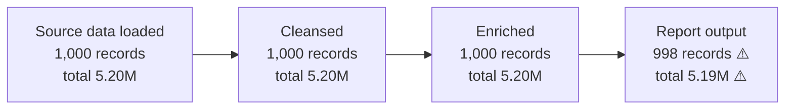
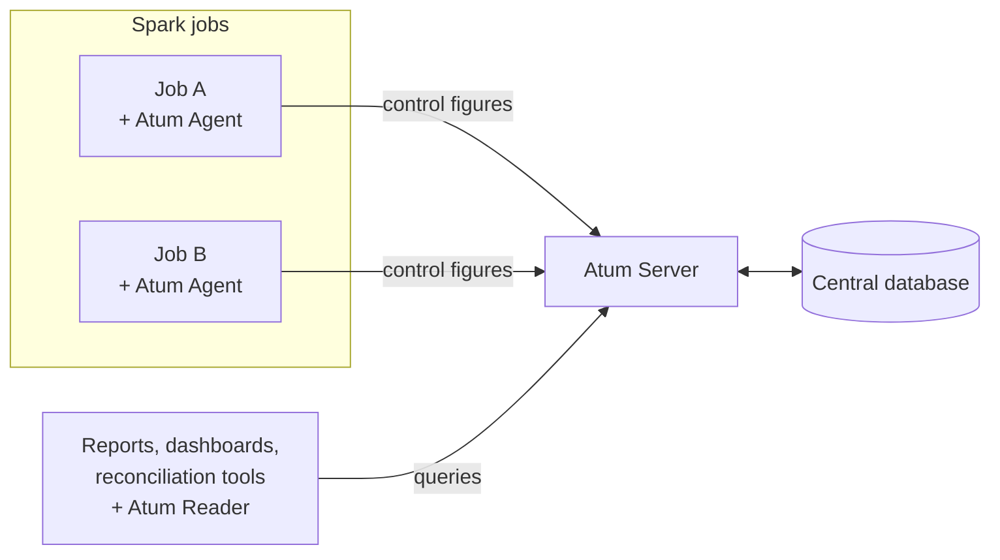
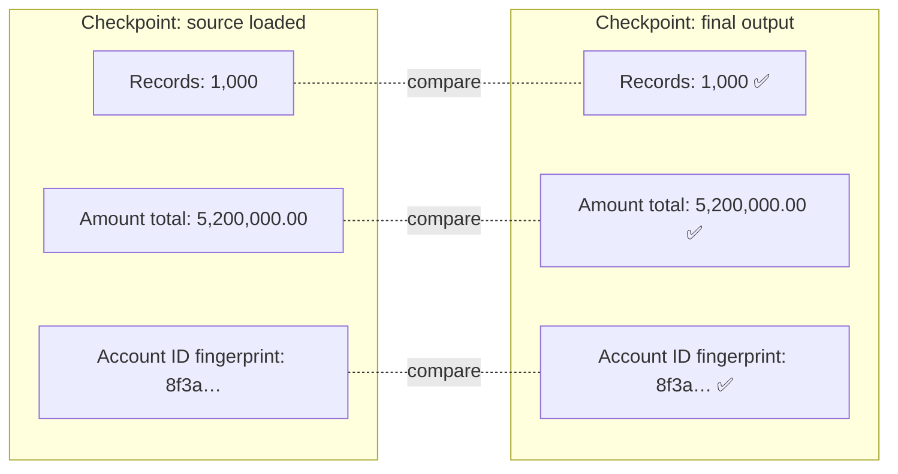
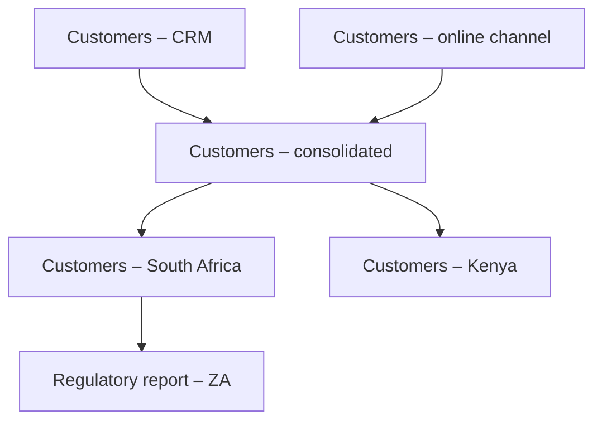
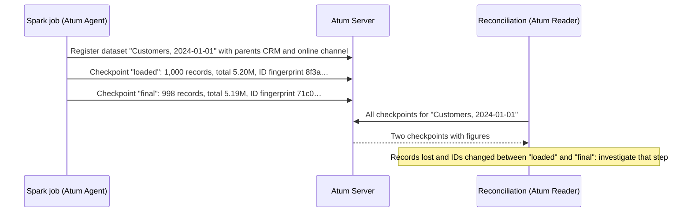

# Atum Service

Atum Service records verifiable consistency evidence that data stays complete and unchanged as it moves through Apache Spark pipelines, and tracks where every dataset came from.

---

## At a glance

Organisations move data through long chains of processing steps: it is loaded from source systems, cleaned, converted, joined with reference data and finally used in reports. Every step is a point where records can be lost, duplicated or altered without anyone noticing.

**Atum Service creates an independent, auditable record of what the data looked like at each step.**

At points you choose (called *checkpoints*), Atum calculates a few control figures for the data:

- **how many records** there are,
- **totals** of important amounts,
- **fingerprints** of key columns, which change if even one value in the column changes.

These figures are stored centrally. Compare them between two checkpoints: if they match, the data is consistent for those measures. If they don't, you know which step changed it. Matching figures are evidence, not proof that every record is unchanged.

Atum also records **lineage**: which datasets were produced from which. You can follow any dataset back to its sources and forward through the pipeline.

Three principles hold throughout:

- **Your data never leaves your job.** Atum stores only control figures and descriptive labels, never the records themselves.
- **Atum records and does not intervene.** It provides the evidence. Your teams and tools decide what to do with it.
- **Adoption is lightweight.** A few lines in an existing Spark job are enough to start.

*Control figures captured at each checkpoint. The difference between "Enriched" and "Report output" shows exactly where two records were lost.*

---

## Why it matters

| Without Atum | With Atum |
|---|---|
| Questions about whether a report is correct lead to days of manual investigation. | Control figures for every step are available side by side. |
| Lost, duplicated or altered records surface weeks later, if at all. | Differences are visible as soon as the figures are compared. |
| Teams assemble audit evidence by hand. | Evidence is captured automatically on every run. |
| The origin of a dataset is known only to the people who built it. | Lineage is recorded centrally and can be queried by anyone. |
| Each team logs quality data in its own format. | One consistent record across teams, applications and pipelines. |

**Key benefits:**

- **Regulatory compliance.** Regulated industries, banking under BCBS 239 for example, must demonstrate data accuracy, completeness and traceability. Atum provides that evidence for every run.
- **Evidence that data was not altered.** Matching column fingerprints and totals are consistency evidence that critical values passed through a pipeline unchanged. They do not prove that every individual record is unchanged, because changes that preserve the figures, such as swapping balances between accounts, would go undetected.
- **Full traceability.** Lineage shows where each dataset came from and what was derived from it, across applications and teams.
- **Faster root-cause analysis.** When a figure is wrong, the checkpoint where it changed points straight to the faulty step.
- **Safer development.** Developers see immediately whether a code change drops, duplicates or alters records.
- **Privacy by design.** Only aggregated figures and labels leave the processing job.
- **Low adoption cost.** It plugs into existing Spark jobs without changing how they work.

---

## How it works

Atum Service consists of three components and a central database.

| Component | Role |
|---|---|
| **Atum Agent** | A library added to a Spark job. At each checkpoint it calculates the control figures and sends them to the server. |
| **Atum Server** | The central service. It receives figures from all agents, stores them, maintains lineage and answers queries. |
| **Database** | A PostgreSQL database holding all control figures, lineage and descriptive information in one place. |
| **Atum Reader** | A library for applications that read the figures back, for example reconciliation reports, dashboards or audit tools. |

---

## Key concepts

**Partitioning: identifying a dataset**
A structured label that uniquely identifies a dataset or a slice of one, for example *source = CRM, snapshot date = 2024-01-01*. All figures and lineage are recorded against this label.

**Measure: what to calculate**
A type of control figure, such as a record count, a column total or a column fingerprint. The full list is under [Guaranteeing completeness and integrity](#guaranteeing-completeness-and-integrity).

**Checkpoint: when to calculate**
A named point in a job where the measures are calculated, for example *"source data loaded"* or *"invalid records removed"*. Each checkpoint records its name, its author, its start and end time, the results, and any custom properties you give it.

**Additional data: context about a dataset**
Descriptive information attached to a dataset, such as application version, source system, owner or run identifier. Every change records who made it.

**Flow: the journey of data**
The chain of datasets connected by lineage: what was derived from what, across one or many applications.

---

## Guaranteeing completeness and integrity

Atum answers two questions about data passing through a pipeline:

1. **Is it complete?** Have any records been lost or added?
2. **Is it unchanged?** Have any critical values been altered?

The measures below answer both. Combining several of them on the same data makes it very hard for an error to go unnoticed.

| Measure | What it detects | Typical use |
|---|---|---|
| **Record count** | Lost or added records | Every checkpoint |
| **Distinct record count** (one or more columns) | Duplicated records or keys | Primary keys, after joins |
| **Sum of values** | Changes to amounts | Balances, transaction amounts |
| **Absolute sum of values** | Changes that a plain total would miss because positive and negative changes cancel out | Debits and credits |
| **Sum of truncated values** | Changes to the whole-number part of values, ignoring rounding noise in decimals | Amounts that are legitimately rounded or converted |
| **Absolute sum of truncated values** | Both of the above combined | Signed amounts with rounding |
| **Column fingerprint** (sum of hashes) | Any change to any value in a column, including text, IDs and dates | Evidence that key identifiers were not altered |
| **Provided figures** | Discrepancies against figures known from elsewhere | Record counts from a source file trailer or a source system |

**How the fingerprint works.** Atum converts every value in the column into a short code (a CRC32 hash) and adds the codes together. If any single value changes, the total almost always changes too. The data does not need to be stored or compared row by row. Matching fingerprints at the start and end of a pipeline are strong evidence that the column's values arrived unchanged, but not proof that they stay attached to the right records.

*Same count, same total, same fingerprint: consistent evidence that the data arrived complete and unaltered for these measures.*

Totals are calculated with overflow protection, so very large amounts are never silently wrapped around. Numbers stored as text are also supported.

---

## Lineage: where data comes from and where it goes

Data is rarely processed in a single straight line. Sources are merged, large datasets are split (by country or business unit, for example) and outputs feed further pipelines. Atum records these relationships as **lineage**.

What Atum supports:

- **Parent-child relationships.** Derive a child dataset from a parent, for example the per-country split above.
- **Multiple parents.** A dataset built from several sources is linked to all of them in one step.
- **Ancestor lookup.** Starting from any dataset, list everything it was derived from, all the way to the original sources.
- **Flows.** Every dataset belongs to a flow. You can list all datasets in a flow and read every checkpoint across the flow in one query, which gives an end-to-end view of a pipeline.
- **Main flow.** Each dataset has a main flow that represents its primary journey.
- **Built-in safeguards.** The server rejects links that would create a loop, or that would rewrite the history of datasets that already have descendants. Re-running a job with the same parents is safe and creates no duplicates.
- **Flexible identification.** A child can extend its parent's label (for example *CRM, 2024-01-01, country = ZA*) or have a label of its own, and stays linked either way.
- **Optional inheritance of measures.** A newly created child can take over its parents' measures, so the same checks continue downstream automatically.

With lineage, you can trace a dataset back through the datasets it was derived from, and read the recorded control figures for each of them. Atum does not record which individual rows or values contributed to a particular figure.

---

## Complete feature overview

**Capturing figures (Atum Agent)**

- Checkpoints anywhere in a Spark job: at the start, between transformations, at the end.
- All eight measures listed above, added or removed at any time.
- Figures already known from elsewhere can be reported as provided figures, without recalculation.
- Custom properties on checkpoints (such as stage or run type) for later searching.
- Additional data attached to datasets.
- Child datasets, multiple parents and optional measure inheritance, as described under lineage.
- Measures defined for a dataset are remembered centrally and restored automatically on the next run.
- Configurable author identity for audit purposes. It defaults to the user running the job.
- Three delivery modes:
  - **Server**: normal operation, with automatic retries, back-off and timeouts.
  - **Console**: figures are printed for local development.
  - **In-memory capture**: for automated tests.
- Supports Spark 3.5 (Scala 2.12 and 2.13) and Spark 4.0 (Scala 2.13).
- Uses the host Spark environment's logging setup without overriding it.

**Storing and serving figures (Atum Server)**

- One central store for figures, lineage and additional data from every team and job.
- A documented REST API with an interactive reference page at `/docs/` on every running server.
- Backward compatible with older agents, so job teams can upgrade at their own pace once the server is upgraded.
- Optional monitoring of HTTP traffic and runtime health, ready for Prometheus and Grafana.
- Available as a Docker image.
- Never receives or stores the underlying business data.

**Querying figures (Atum Reader and API)**

- Look up a dataset by its label and read its checkpoints, additional data and author.
- Read all checkpoints across an entire flow.
- Filter checkpoints by name, by custom properties, or by time window, newest first if needed.
- Page through large result sets.
- Usable from any Java or Scala application. Spark is not required.

---

## Typical usage

1. A data engineer adds the Atum Agent to a Spark job, defines the dataset label and selects measures.
2. Checkpoints are placed at the key stages of the job.
3. On every run, the agent sends the control figures and lineage links to the Atum Server.
4. Reconciliation reports, dashboards, data stewards or auditors read the figures back and compare them.
5. Any mismatch points to the exact step and dataset to investigate.

---

## Further reading

This page is a functional overview. For installation, configuration and code examples, see:

- **Source code and main documentation:** [github.com/AbsaOSS/atum-service](https://github.com/AbsaOSS/atum-service)
- **Getting started with the Agent (code examples):** [Usage section of the README](https://github.com/AbsaOSS/atum-service#usage)
- **Agent details, sub-contexts and multiple parents:** [agent/README.md](https://github.com/AbsaOSS/atum-service/blob/master/agent/README.md)
- **Running and monitoring the Server:** [server/README.md](https://github.com/AbsaOSS/atum-service/blob/master/server/README.md)
- **Database setup:** [database/README.md](https://github.com/AbsaOSS/atum-service/blob/master/database/README.md)
- **Release notes:** [GitHub Releases](https://github.com/AbsaOSS/atum-service/releases)
- **Libraries on Maven Central:** [za.co.absa.atum-service](https://central.sonatype.com/search?namespace=za.co.absa.atum-service)
- **Questions and feature requests:** [GitHub Issues](https://github.com/AbsaOSS/atum-service/issues)
